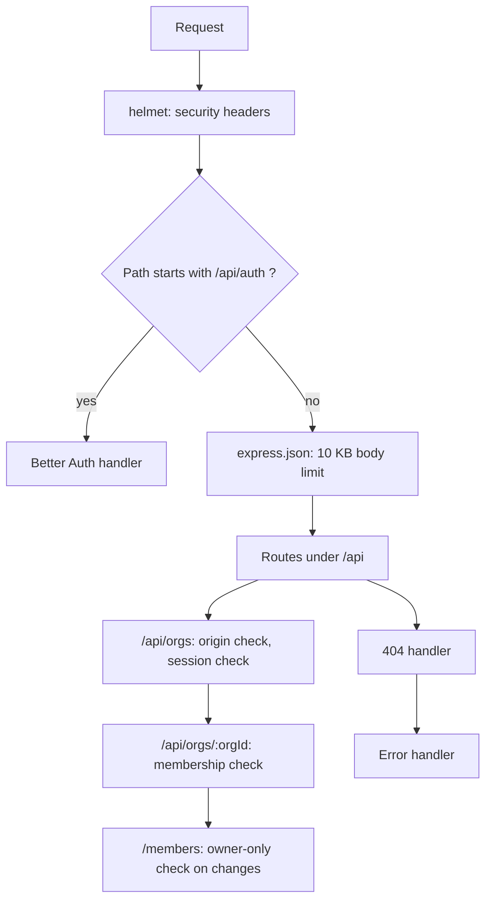

# SlotDesk design notes

These notes explain how SlotDesk is built and why. They describe what exists in this repository today. Where something is planned but not built, it says so.

Comments in the code refer to decisions by ID (for example `D-012`). The decision log those IDs come from is not part of this repository, so each decision the code cites is summarised here:

| Section | Decisions |
|---|---|
| [1. Request path](#1-request-path) | D-011, D-030 |
| [2. Tenant isolation](#2-tenant-isolation) | D-011, D-030 |
| [3. No double booking](#3-no-double-booking) | D-012, D-026 |
| [4. Data model and database access](#4-data-model-and-database-access) | D-014, D-021, D-025, D-026 |
| [5. Authentication](#5-authentication) | D-001, D-029, D-031 |
| [6. Configuration and deployment](#6-configuration-and-deployment) | D-022, D-031 |
| [7. Testing](#7-testing) | D-016 |
| [8. Known limits](#8-known-limits) | |

## 1. Request path

Every request passes through the same Express 5 pipeline, in this order:

Two ordering rules matter. The Better Auth handler must come before `express.json()`, or auth requests hang. And every route lives under `/api`, so that when a React app is served from the same origin later, an API path can never collide with a page URL.

Routes handle HTTP and input validation (Zod). The SQL lives in separate data functions in `src/data/`. There is no service layer yet, because there are no business rules to put in one.

## 2. Tenant isolation

*Decisions D-011 and D-030.*

SlotDesk uses one shared database schema for all organizations. Isolation is enforced in layers, because no single layer is enough:

1. **The organization comes from the URL** (`/api/orgs/:orgId/...`), never from a request body.
2. **A membership check runs on every organization route.** One query reads the caller's role from `memberships` for `(org_id, user_id)`. If there is no row, the answer is 404, the same body as an unknown route, so a non-member cannot tell whether an organization exists. A malformed `orgId` (not plain digits, or too large for a `bigint`) gets 404 without touching the database.
3. **Every query on tenant data takes the organization ID as its first argument and filters on `org_id`.**
4. **Composite foreign keys.** Tenant tables reference each other by `(org_id, id)`, so a booking cannot point at another organization's resource. The database refuses it.
5. **An isolation test for every tenant endpoint.** A member of organization B must get exactly the same answer for organization A as for an organization that does not exist.

The weak point is stated plainly: composite foreign keys stop cross-tenant references, but they do not stop a query that forgets its `org_id` filter. Layers 3 and 5 exist for that reason. Row-level security was considered and left out of the first version.

**Roles.** An organization has one owner and any number of staff. The database allows at most one owner per organization (a partial unique index). Only the owner can add or remove members; staff get 403. An organization and its owner membership are created in one transaction.

**Origin check on our own routes.** Better Auth checks the `Origin` header on its own routes only. Requests that change data under `/api/orgs` need the same protection, so a small middleware requires the `Origin` header to equal the origin of `BETTER_AUTH_URL`, and answers 403 otherwise.

**Session check.** The session lookup uses Better Auth's `getSession` with `disableRefresh`. Without it, a server-side call extends the session in the database but cannot send the new cookie to the browser, so the database row would outlive the cookie. With it, this check never writes.

## 3. No double booking

*Decisions D-012 and D-026.*

Two people booking the same slot at the same moment is the classic race. An application-level "is it free?" check is not safe, because both requests can see "free" before either writes.

So the guarantee lives in the database. The `bookings` table has an exclusion constraint:

- It compares each confirmed booking's time range, `[starts_at, ends_at)`, for the same resource, and rejects any overlap (PostgreSQL error `23P01`).
- It applies only to rows with `status = 'confirmed'`, so cancelled bookings free their slot.
- All times are `timestamptz`, stored in UTC. Each resource has an IANA time zone for display and slot generation.

The planned booking transaction is: begin, lock the resource row (scoped to the organization), validate, insert, commit. The constraint decides who wins. The lock does not provide correctness: it makes losers fail quickly and cleanly. In a test without it, the first failing round had 29 of 30 simultaneous attempts fail with deadlocks (error `40P01`) instead of a clean rejection.

What is built: the tables, the constraint, and tests that prove it (section 7). What is not built yet: the booking routes themselves, retry on deadlock, and the mapping of database errors to HTTP responses. Those are next.

The constraint covers overlaps only. Working hours and similar rules will be application rules, so code that bypasses the API could break them. That limit is accepted.

## 4. Data model and database access

*Decisions D-014, D-021, D-025 and D-026.*

**Tables.** `organizations`, `resources`, `bookings`, `memberships`, and four identity tables (`users`, `sessions`, `accounts`, `verifications`). Migrations are plain SQL files in `server/migrations/`, each with a real down step.

**Keys and names.**

- Names are snake_case and plural.
- Our own tables use `bigint GENERATED ALWAYS AS IDENTITY` primary keys.
- User IDs are `text`, because Better Auth generates its own 32-character string IDs. We do not change its ID generation to suit our tables.
- Link tables use their natural key. `memberships` has the primary key `(org_id, user_id)` and no `id`, because nothing would use one.
- Every constraint has an explicit name, so tests and error handling can refer to it.
- Our tables never cascade deletes. Deleting a row that other rows depend on is refused. The one exception is the identity tables, where sessions and accounts belong to the user and follow it, as the library designs them.

**Identity tables.** Better Auth's models are mapped to our naming (`modelName` and `fields` in `src/auth.ts`), and the tables are created by our own migration, never by the library's command line tool. The migration was compared line by line with the schema the library generates, and the library's startup schema check accepts it.

**Database access.** The app uses `pg` with hand-written, parameterized SQL and no ORM, because exclusion constraints cannot be written in the schema language of Prisma, the ORM that was considered. One rule came out of testing lost connections: a client taken from the pool with `pool.connect()` gets its own `'error'` listener while it is checked out and is released in a `finally` block. Without that, a dropped connection stops the whole Node process. Tests kill real connections to prove it.

## 5. Authentication

*Decisions D-001, D-029 and D-031.*

SlotDesk uses Better Auth (core only, no plugins, exact version pin) with email and password. Sessions are stored in our own PostgreSQL tables, in the same database as everything else.

The settings that matter:

- **Password rules.** Minimum 15 characters, maximum 128. No password reset and no email verification in the first version.
- **Origin checks always on.** Better Auth skips its origin and CSRF checks when `NODE_ENV` is `test` or a `TEST` variable is set. The setting `advanced.disableOriginCheck: false` keeps them on in every environment.
- **HTTPS in production.** The app refuses to start in production unless `BETTER_AUTH_URL` starts with `https://`. On the deployed service the cookie is `__Secure-better-auth.session_token` with `HttpOnly; Secure; SameSite=Lax`.
- **Rate limiting** is Better Auth's, in memory, and active in production only: three sign-in or sign-up requests per 10 seconds per client address. The deployed service sits behind Cloudflare, so the client address is read only from `cf-connecting-ip`. A forged copy of that header is rejected by Cloudflare before it reaches the app. Our own routes have no rate limit yet.
- **Password hashing** is our own code in `src/password.ts`, passed to Better Auth as its `hash` and `verify`. It uses scrypt with N=2^15, r=8, p=3. OWASP's minimum is N=2^17, r=8, p=1, and it lists N=2^15, r=8, p=3 as equivalent (32 MiB of memory per hash instead of 128 MiB). The settings are stored inside each hash (`scrypt:N:r:p:salt:key`), so the cost can be changed later while old hashes still verify. Passwords are NFKC-normalised, hashes are compared in constant time, and the settings read back from a stored hash have upper limits. A malformed stored hash throws, which becomes a 500 and never a wrong-password 401. The cost was measured on the free Render instance before any real account existed: a warm sign-in takes about 1.7 seconds there. That is slower than the 1.5 seconds first aimed for, and the cost was kept anyway: sign-in is rare, and most of the time is the free instance's small CPU.

Better Auth was adopted provisionally. The remaining check, that the future React client calls `/api/auth/get-session` and trusts one origin in both places, waits for the client.

## 6. Configuration and deployment

*Decisions D-022 and D-031.*

**Configuration.** All environment variables are checked at startup by one Zod schema in `src/config.ts`. A bad `PORT`, `DATABASE_URL`, `BETTER_AUTH_SECRET` (at least 32 characters) or `BETTER_AUTH_URL` stops the app with a message that names the variable and never prints its value. `.env` files are loaded with Node's `--env-file-if-exists` flag, so there is no `dotenv` package. The example files are committed, and the real ones are git-ignored.

**Local.** `docker-compose.yml` runs PostgreSQL 17 with two databases, `slotdesk` and `slotdesk_test`. The Compose variables and the app variables are in separate files so each tool reads only its own.

**Deployed.** The API runs on a free Render web service, with a Neon PostgreSQL database. Choices that came out of the first deploy:

- **One direct database URL** for the app and migrations. Neon's pooled endpoint (PgBouncer in transaction mode) solves a problem a single long-lived process does not have.
- **Migrations run at the end of Render's build command**, so `node-pg-migrate` stays a development dependency and the production dependency audit stays clean.
- **A fresh production secret**, set only in Render.
- **Measured, not assumed.** Cold start after idling was about 23 to 33 seconds. Warm sign-in is about 1.7 seconds. Both are on the free tier, and both are expected to change with a paid instance.

## 7. Testing

*Decision D-016.*

| Command | What it covers |
|---|---|
| `npm test` | Unit tests. No database needed. |
| `npm run test:db` | Database tests against `slotdesk_test`: table rules, booking races, authentication checks, and the organization and member routes through the real app. |

The database tests commit for real, create their own data, and run one file at a time. A guard refuses to run unless the database name ends in `_test`, and the guard has its own test.

The booking concurrency tests have three layers, two of which are built:

1. **Database race.** 30 independent connections try to book one slot, over 20 rounds. Exactly one must win each round, every other attempt must fail with `23P01` on `bookings_no_overlap`, and afterwards there must be 20 confirmed bookings with no overlapping pair. This uses separate connections started in one synchronous loop, not a connection pool, so the attempts really are simultaneous.
2. **HTTP race** (planned, with the booking routes).
3. **Mutation proof.** The same harness runs against a scratch schema with no constraint and a check-then-insert. It must produce more than one winner in some round, and fails otherwise. This proves the race harness can detect a double booking, so a passing layer 1 means something.

CI (GitHub Actions) runs type-check, lint, format check, build, unit tests, migrations and the database tests against PostgreSQL 17, a check that no file is stored with Windows line endings, and a dependency audit.

## 8. Known limits

- Session tokens are stored in plain text in the `sessions` table, as Better Auth currently does, and signing out fails open: if the database is down during sign-out the response is still 200 and the session row stays valid. Both are accepted for now.
- Our own routes have no rate limit and list endpoints have no pagination. Both are marked in the code as shortcuts.
- The free Render instance hashes about one password at a time, so a burst of sign-in attempts from many addresses would slow everyone's sign-in.
- Two clients hitting the rate limit at the same moment, and any way of reaching the service without going through Cloudflare, have not been tested.
- Booking routes, services, availability and the React client do not exist yet.
