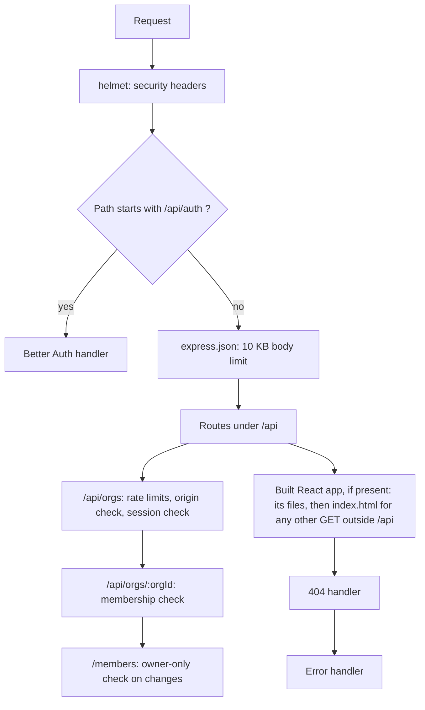

# SlotDesk design notes

These notes explain how SlotDesk is built and why. They describe what exists in this repository today. Where something is planned but not built, it says so.

Comments in the code refer to decisions by ID (for example `D-012`). The decision log those IDs come from is not part of this repository, so each decision the code cites is summarised here:

| Section | Decisions |
|---|---|
| [1. Request path](#1-request-path) | D-011, D-019, D-030 |
| [2. Tenant isolation](#2-tenant-isolation) | D-011, D-030 |
| [3. No double booking](#3-no-double-booking) | D-012, D-026, D-033 |
| [4. Data model and database access](#4-data-model-and-database-access) | D-014, D-021, D-025, D-026, D-032 |
| [5. Authentication](#5-authentication) | D-001, D-029, D-031 |
| [6. Configuration and deployment](#6-configuration-and-deployment) | D-022, D-031 |
| [7. Testing](#7-testing) | D-016, D-027 |
| [8. Known limits](#8-known-limits) | |

## 1. Request path

Every request passes through the same Express 5 pipeline, in this order:

Two ordering rules matter. The Better Auth handler must come before `express.json()`, or auth requests hang. And every route lives under `/api`, so the React app can share the API's origin without an API path ever colliding with a page URL. The app is served after the API routes, and a path starting with `/api` never gets the page, in any letter case, so a wrong API URL still gets the JSON 404.

Routes handle HTTP and input validation (Zod). The SQL lives in separate data functions in `src/data/`. There is no separate service layer. The one rule that needs more than a query, accepting a booking only for a start the availability function would offer, runs inside the booking transaction in `src/data/bookings.ts` (section 3).

## 2. Tenant isolation

*Decisions D-011 and D-030.*

SlotDesk uses one shared database schema for all organizations. Isolation is enforced in layers, because no single layer is enough:

1. **The organization comes from the URL** (`/api/orgs/:orgId/...`), never from a request body.
2. **A membership check runs on every organization route.** One query reads the caller's role from `memberships` for `(org_id, user_id)`. If there is no row, the answer is 404, the same body as an unknown route, so a non-member cannot tell whether an organization exists. A malformed `orgId` (not plain digits, or too large for a `bigint`) gets 404 without touching the database.
3. **Every query on tenant data takes the organization ID as its first argument and filters on `org_id`.**
4. **Composite foreign keys.** Tenant tables reference each other by `(org_id, id)`, so a booking cannot point at another organization's resource or service. The database refuses it.
5. **An isolation test for every tenant endpoint.** A member of organization B must get exactly the same answer for organization A as for an organization that does not exist.

The weak point is stated plainly: composite foreign keys stop cross-tenant references, but they do not stop a query that forgets its `org_id` filter. Layers 3 and 5 exist for that reason. Row-level security was considered and left out of the first version.

**Roles.** An organization has one owner and any number of staff. The database allows at most one owner per organization (a partial unique index). Only the owner can add or remove members, and create or rename resources; the owner also creates and updates services and sets working hours; staff get 403 on those and can only read resources, services and working hours. An organization and its owner membership are created in one transaction.

**Origin check on our own routes.** Better Auth checks the `Origin` header on its own routes only. Requests that change data under `/api/orgs` need the same protection, so a small middleware requires the `Origin` header to equal the origin of `BETTER_AUTH_URL`, and answers 403 otherwise.

**Session check.** The session lookup uses Better Auth's `getSession` with `disableRefresh`. Without it, a server-side call extends the session in the database but cannot send the new cookie to the browser, so the database row would outlive the cookie. With it, this check never writes.

## 3. No double booking

*Decisions D-012, D-026 and D-033.*

Two people booking the same slot at the same moment is the classic race. An application-level "is it free?" check is not safe, because both requests can see "free" before either writes.

So the guarantee lives in the database. The `bookings` table has an exclusion constraint:

- It compares each confirmed booking's time range, `[starts_at, ends_at)`, for the same resource, and rejects any overlap (PostgreSQL error `23P01`).
- It applies only to rows with `status = 'confirmed'`, so cancelled bookings free their slot.
- All times are `timestamptz`, stored in UTC. Each resource has an IANA time zone for display and slot generation.

The booking transaction is: begin, lock the resource row (scoped to the organization), validate, insert, commit. The constraint decides who wins. The lock does not provide correctness: it makes losers fail quickly and cleanly. In a test without it, the first failing round had 29 of 30 simultaneous attempts fail with deadlocks (error `40P01`) instead of a clean rejection.

What is built: the tables, the constraint, tests that prove it (section 7), and the mapping of database errors to HTTP responses: an overlap or a duplicate is 409, a bad reference is 404 (the same answer as a missing row), a bad value is 400, and a deadlock or serialization failure is 503 with `Retry-After: 1`. Deadlocks are not retried automatically: with the resource row locked first none are expected, so retry code would only hide a new locking bug. The mapped errors are logged with the error code, constraint name and table name only, never the rejected values. Creating a booking is built (`POST /api/orgs/:orgId/bookings`): inside the transaction it reads the service and working hours, accepts the start only if the availability function would offer it, and sets the end from the service's duration. That check never looks at other bookings; an overlap is left to the constraint, which answers 409. Because saving working hours takes the same lock, the hours cannot change between the check and the insert. Listing, viewing and cancelling are built too. Cancelling sets the status to `cancelled` in one update, with no lock, because it can never create an overlap; the row stays, so the list shows cancelled bookings with their status. The list takes local dates in the resource's time zone and turns them into one exact UTC range in `src/availability.ts`, so a booking is listed on the local date it starts.

**Retrying a booking.** If a booking is made but its answer is lost (a dropped connection, a sleeping phone), pressing Book again would hit the booking that was just made and get a 409. So both booking routes take an `Idempotency-Key` header, written as the IETF draft writes it: one quoted string, here always a UUID. Each booking dialog makes one key when it opens and sends it on every try. The key is stored with the booking, unique per organization (`bookings_org_idempotency_key_key`), so one business can never find another's booking by its key. Inside the booking transaction the lookup comes right after the resource lock: copies of one request name the same resource, so the second waits for the first to commit, finds its booking and answers with it, and both get the same 201. It comes before every other check, so a repeat gets its booking even once the start has passed or the day's online cap is used up, and never counts towards the cap again. The same key with different details (resource, service, start, name, email, or staff versus online) is refused with 422 `{ "error": "Idempotency key reused" }`, which says nothing about the stored booking. A key that is not one quoted UUID is a 400. The header is optional: without it a booking works as before. Only bookings made with a key store one, and it is kept as long as the booking. Online bookings still need a passing bot check on every try.

The constraint covers overlaps only. Working hours and similar rules are application rules, so code that bypasses the API could break them. That limit is accepted.

## 4. Data model and database access

*Decisions D-014, D-021, D-025, D-026 and D-032.*

**Tables.** `organizations`, `resources`, `services`, `working_hours`, `bookings`, `memberships`, and four identity tables (`users`, `sessions`, `accounts`, `verifications`). Migrations are plain SQL files in `server/migrations/`, each with a real down step.

**Keys and names.**

- Names are snake_case and plural.
- Our own tables use `bigint GENERATED ALWAYS AS IDENTITY` primary keys.
- User IDs are `text`, because Better Auth generates its own 32-character string IDs. We do not change its ID generation to suit our tables.
- Link tables use their natural key. `memberships` has the primary key `(org_id, user_id)` and no `id`, because nothing would use one.
- Every constraint has an explicit name, so tests and error handling can refer to it.
- Our tables never cascade deletes. Deleting a row that other rows depend on is refused. The one exception is the identity tables, where sessions and accounts belong to the user and follow it, as the library designs them.

**Identity tables.** Better Auth's models are mapped to our naming (`modelName` and `fields` in `src/auth.ts`), and the tables are created by our own migration, never by the library's command line tool. The migration was compared line by line with the schema the library generates, and the library's startup schema check accepts it.

**Database access.** The app uses `pg` with hand-written, parameterized SQL and no ORM, because exclusion constraints cannot be written in the schema language of Prisma, the ORM that was considered. One rule came out of testing lost connections: a client taken from the pool with `pool.connect()` gets its own `'error'` listener while it is checked out and is released in a `finally` block. Without that, a dropped connection stops the whole Node process. Tests kill real connections to prove it.

**Resource time zones.** A resource's `time_zone` is an IANA name, checked and normalised with `temporal-polyfill` when the resource is created (for example `asia/kolkata` is stored as `Asia/Kolkata`). It is fixed afterwards, because changing it would move every working-hours window while bookings stay as UTC instants. Offsets such as `+05:30` are refused. The check does not use `Intl.supportedValuesOf`, which lacks `Asia/Kolkata` on Node 24 (D-032).

**Services.** A service has a name and a duration of 5 to 480 minutes in steps of 5, checked by the API and by a database `CHECK`. Every resource offers every service for now, so there is no table linking them (D-032).

**Working hours.** Each resource has weekly windows stored as minutes since local midnight in its own time zone. A database exclusion constraint refuses overlapping windows on the same day (touching ones are allowed), and a `CHECK` keeps minutes between 0 and 1440. Saving replaces the whole week in one transaction that first locks the resource row, so two saves at once cannot interleave (D-032).

**Availability.** One pure function in `src/availability.ts` turns a resource's working hours into UTC start times every 15 minutes where the service fits, leaving out the past and anything that overlaps a confirmed booking. It is given the current time instead of reading the clock, so tests control it. Wall-clock times that do not exist or happen twice on DST days are converted with Temporal's `compatible` rule (a missing time moves later, a repeated time takes the earlier instant), and slots step in real minutes, so a window that spans a clock change is as long as the time that really passes. Unit tests cover New York's two changes and India. The result is a hint: the booking constraint decides (D-032).

## 5. Authentication

*Decisions D-001, D-029 and D-031.*

SlotDesk uses Better Auth (core only, no plugins, exact version pin) with email and password. Sessions are stored in our own PostgreSQL tables, in the same database as everything else.

The settings that matter:

- **Password rules.** Minimum 15 characters, maximum 128. No password reset and no email verification in the first version.
- **Origin checks always on.** Better Auth skips its origin and CSRF checks when `NODE_ENV` is `test` or a `TEST` variable is set. The setting `advanced.disableOriginCheck: false` keeps them on in every environment.
- **HTTPS in production.** The app refuses to start in production unless `BETTER_AUTH_URL` starts with `https://`. On the deployed service the cookie is `__Secure-better-auth.session_token` with `HttpOnly; Secure; SameSite=Lax`.
- **Rate limiting** is Better Auth's, in memory, and active in production only: three sign-in or sign-up requests per 10 seconds per client address. The deployed service sits behind Cloudflare, so the client address is read only from `cf-connecting-ip`. A forged copy of that header is rejected by Cloudflare before it reaches the app.
- **Rate limits on our own routes.** `/api/orgs` has two limits per client address (the same header) in each 15 minutes: 100 requests that change data, and 600 requests of any kind. Over a limit the answer is 429 `{ "error": "Too Many Requests" }` with `Retry-After`. They run before the origin check and the session lookup, so a flood never costs a database query. The writes limit exists because anyone can sign up, and one account could otherwise fill the free database; the all-requests limit protects the free instance's small CPU and the database's monthly compute hours. Counts are kept in memory. IPv6 addresses in the same /56 share one count. `/api/health` is not limited, and `/api/auth` has Better Auth's own limit.
- **Password hashing** is our own code in `src/password.ts`, passed to Better Auth as its `hash` and `verify`. It uses scrypt with N=2^15, r=8, p=3. OWASP's minimum is N=2^17, r=8, p=1, and it lists N=2^15, r=8, p=3 as equivalent (32 MiB of memory per hash instead of 128 MiB). The settings are stored inside each hash (`scrypt:N:r:p:salt:key`), so the cost can be changed later while old hashes still verify. Passwords are NFKC-normalised, hashes are compared in constant time, and the settings read back from a stored hash have upper limits. A malformed stored hash throws, which becomes a 500 and never a wrong-password 401. The cost was measured on the free Render instance before any real account existed: a warm sign-in takes about 1.7 seconds there. That is slower than the 1.5 seconds first aimed for, and the cost was kept anyway: sign-in is rare, and most of the time is the free instance's small CPU.

Better Auth was adopted provisionally, then confirmed once the React client existed: the client calls `/api/auth/get-session` on its own origin, the server trusts that one origin (`BETTER_AUTH_URL`), and on the deployed service every browser request that changes data passed the exact `Origin` check.

## 6. Configuration and deployment

*Decisions D-022 and D-031.*

**Configuration.** All environment variables are checked at startup by one Zod schema in `src/config.ts`. A bad `PORT`, `DATABASE_URL`, `BETTER_AUTH_SECRET` (at least 32 characters) or `BETTER_AUTH_URL` stops the app with a message that names the variable and never prints its value. `.env` files are loaded with Node's `--env-file-if-exists` flag, so there is no `dotenv` package. The example files are committed, and the real ones are git-ignored.

**Local.** `docker-compose.yml` runs PostgreSQL 17 with two databases, `slotdesk` and `slotdesk_test`. The Compose variables and the app variables are in separate files so each tool reads only its own.

**Deployed.** The API runs on a free Render web service, with a Neon PostgreSQL database. The service builds from the repository root: first the client, then the server, then the migrations. The server then serves the built client, so the browser sees one address and needs no CORS. Choices that came out of the first deploy:

- **One direct database URL** for the app and migrations. Neon's pooled endpoint (PgBouncer in transaction mode) solves a problem a single long-lived process does not have.
- **Migrations run at the end of Render's build command**, so `node-pg-migrate` stays a development dependency and the production dependency audit stays clean.
- **A fresh production secret**, set only in Render.
- **Measured, not assumed.** Cold start after idling was about 23 to 33 seconds. Warm sign-in is about 1.7 seconds. Both are on the free tier, and both are expected to change with a paid instance.

## 7. Testing

*Decisions D-016 and D-027.*

| Command | What it covers |
|---|---|
| `npm test` | Unit tests, including the availability and daylight saving time cases. No database needed. |
| `npm run test:db` | Database tests against `slotdesk_test`: table rules, booking races (including copies of one request with the same idempotency key), authentication checks, and the organization, member, resource, service, working-hours, availability and booking routes through the real app. |
| `npm test` in `client` | Testing Library tests of the screens, rendering the real routes against a fake API. |
| `npm test` in `e2e` | A Playwright smoke test in Chromium: the built client and server against a real database. It signs up, adds sample data and books a slot, and checks that the sign-in page looks the same in light and dark mode. |

The database tests commit for real, create their own data, and run one file at a time. A guard refuses to run unless the database name ends in `_test`, and the guard has its own test.

The booking concurrency tests have three layers:

1. **Database race.** 30 independent connections try to book one slot, over 20 rounds. Exactly one must win each round, every other attempt must fail with `23P01` on `bookings_no_overlap`, and afterwards there must be 20 confirmed bookings with no overlapping pair. This uses separate connections started in one synchronous loop, not a connection pool, so the attempts really are simultaneous.
2. **HTTP race.** 10 simultaneous requests to the booking route on one running server, over 20 rounds, in two shapes. Identical slot: exactly one 201 and nine 409s each round. Staggered: starts 15 minutes apart with a 60-minute service, so each request overlaps its neighbours; every answer must be 201 or 409, and every 409 must overlap a booking that won. A deadlock is answered with 503, so the staggered race is what proves the resource-row lock: with the lock removed it fails on almost every run. Both tests also check that all requests were sent before the first answer arrived.
3. **Mutation proof.** The same harness runs against a scratch schema with no constraint and a check-then-insert. It must produce more than one winner in some round, and fails otherwise. This proves the race harness can detect a double booking, so a passing layer 1 means something.

CI (GitHub Actions) runs a check that no file is stored with Windows line endings; for the server, type-check, lint, format check, build, unit tests, migrations and the database tests against PostgreSQL 17; for the client, type-check, lint, format check, tests and build; the smoke test; and a dependency audit of the server, the client and `e2e`. An advisory with no fix can be accepted only by listing it, with a reason and an expiry date, in `server/audit-exceptions.json`; an expired or no-longer-needed entry fails the audit too.

## 8. Known limits

- Session tokens are stored in plain text in the `sessions` table, as Better Auth currently does, and signing out fails open: if the database is down during sign-out the response is still 200 and the session row stays valid. Both are accepted for now.
- Our rate limits count per client address in memory, and list endpoints have no pagination. Both are marked in the code as shortcuts. A restart resets the counts, and a second server instance would double the limits.
- Someone with many addresses is not stopped by a per-address limit, so they could fill the free database with junk rows. The database then refuses new writes instead of billing us, existing data stays safe, and the fix is to delete the junk. A cap per account is the next step, then a CAPTCHA on sign-up (parked until the application is finished, with email verification).
- Several users behind one address, such as an office or a mobile carrier's shared address, share one count.
- The free Render instance hashes about one password at a time, so a burst of sign-in attempts from many addresses would slow everyone's sign-in.
- Two clients hitting the rate limit at the same moment, and any way of reaching the service without going through Cloudflare, have not been tested.
- A booking cannot be edited or un-cancelled; cancel it and book again.
- Availability and booking are members-only for now (staff book for guest customers), and a booking that would run across two touching working-hours windows (for example 09:00 to 13:00 and 13:00 to 17:00) is not offered or accepted.
- A retry is recognised only inside one booking dialog: closing it and booking the same slot again makes a new key, so that try still gets a 409 for its own booking. A repeat is answered from the booking as it is now, so if staff cancel it in between, a staff repeat shows it as cancelled and the online page still says "You're booked". The same key sent at the same moment for two different resources gets a 409 instead of a 422 (our clients never do this).
- Working hours cannot run past midnight, and there are no holidays, time off or buffers between bookings.
- Every resource offers every service; there is no way to say a resource does not perform one. Services cannot be deleted.
- The time zone of a resource cannot be changed after creation.
